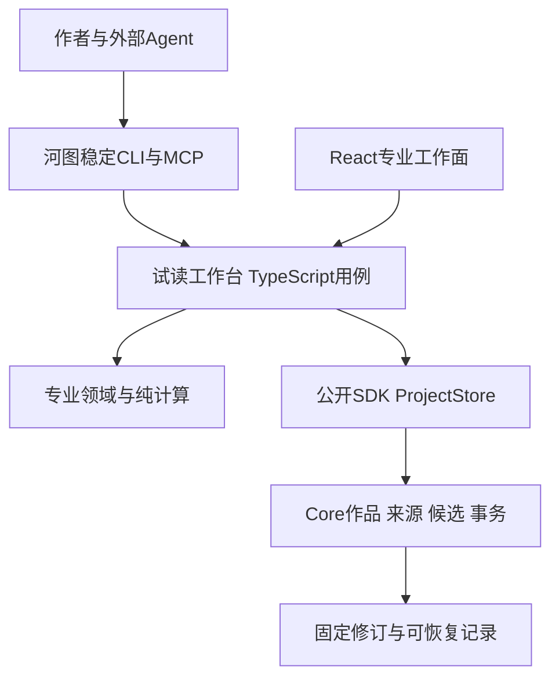

# 架构与领域设计

## 分层与技术选型

TypeScript实现领域不变量与专业用例；React展示审阅面；JSON Schema闭合输入；公开ProjectStore/SDK适配固定来源、CAS和原键。受管Node25执行插件后端，Cordis生命周期由宿主提供，插件不依赖其私有服务。Rust仅负责共享Core，不要求开发Rust扩展。

## 本体与Owner

试读包、读者、提交、原始意见、处理决定属于本插件，来源中的正文、素材和正式设定属于宿主。观察、规划、模拟、实际成果与作者决定分别表达。跨插件依据保存Owner、对象、修订和摘要；不同作品必须分别操作。

## 聚合与持久化

一个专业工程是一个聚合，具有格式版本、标题、专业记录及basis_refs；宿主扩展对象携带WorkRef、Owner、Schema版本和source_refs。保存形成不可变历史修订；不引入第二个数据库。大媒体由素材库持有，工程只保存固定来源索引。

## 关键不变量

离线包不自动发送或上传。真实读者和Agent模拟分开，模拟意见不计真实人数或满意度。反馈固定包摘要与选区序号，原始意见保持，处理决定另存；新版不静默套旧坐标。包内JavaScript只维护本机表单及下载JSON，嵌入内容转义，不执行反馈中的代码。

遵守KISS与YAGNI：仅实现当前完整旅程所需结构；共享存取由公开SDK承担，专业算法不进入Core。
