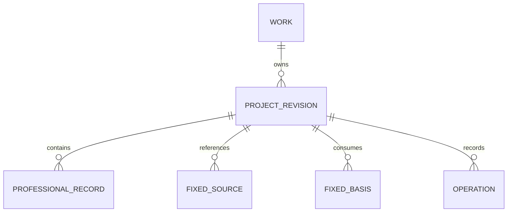

# 数据与API设计

## 数据合同

工程根结构为format_version、title、basis_refs及本专业集合。每条记录使用稳定id，外部关系不得靠标题匹配；引用必须存在，数组有预算，未知字段拒绝。正式字段以contracts/plugin-manifest.json中的Schema为唯一来源。

## 存储设计

Core现有扩展对象仓储负责身份、对象修订、摘要、来源及审计。专业字段整体CAS保存，历史保持。没有插件私有SQLite，不直接操作宿主数据库或.hetu文件。单工程512KiB、来源最多100项；接近预算按固定范围分工程。

## 公开API

通过hetu.plugins.capabilities发现，再由hetu.plugins.invoke调用专业动作。通用动作包含list_projects、get_project、save_project、get_source、get_basis、compare_versions、export_project、build_context、create_handoff、get_operation；专业动作及完整Schema由包内CAPABILITIES与operations资源生成，避免文档复制字段漂移。

写入携带object_id（新建省略）、expected_revision、expected_sha256、operation_key及确切内容。source_refs已有项不可替换，只能追加新修订；basis_refs固定Owner及摘要。

## 错误与恢复

参数非法返回invalid_input，过期基线revision_conflict，依据变化hetu.stale_evidence，超预算hetu.budget_exceeded。未知结果沿原operation_key查询，只有明确not_found才能用原输入、原键继续；不得换键重发。导出按固定对象分块，核验偏移、总长度及分块和完整摘要。

大工程写入和原键回读可传detail=summary，返回固定对象元数据及content_read；按固定修订export_project的8192字节JSON分块恢复完整工程。get_source按UTF-8偏移分块，complete只表示返回范围，不表示已理解全文。GUI可在受管桌面传输使用full；不能为机器入口切换all-tools或依赖窗口。
