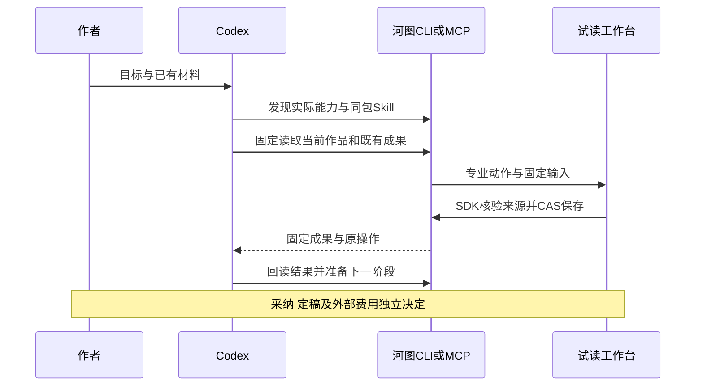

# Skill与机器协作

## 注册与发现

Skill随河图插件manifest声明，通过现有稳定CLI/MCP动态列出和按需读取；没有独立Codex插件、MCP服务或客户端工具名。安装/升级/启停后重新发现包和能力摘要。

## 方法要求

先读现有成果与来源，按实际覆盖组织本次目标；完成选择固定阅读范围→导出离线试读包→读者本地填写→预览反馈文件→固定导入→聚合分歧→作者决定→新稿复核。动作参数以发现Schema为准，方法不赋予额外权限。跨作品Agent分别读取，专业插件不得合并management_ref。

离线包不自动发送或上传。真实读者和Agent模拟分开，模拟意见不计真实人数或满意度。反馈固定包摘要与选区序号，原始意见保持，处理决定另存；新版不静默套旧坐标。包内JavaScript只维护本机表单及下载JSON，嵌入内容转义，不执行反馈中的代码。

包内SKILL保持简洁，operations导航实际动作，workflows承接专业正反例；测试需要当前Codex连接真的读取方法并完成至少一次专业动作。
